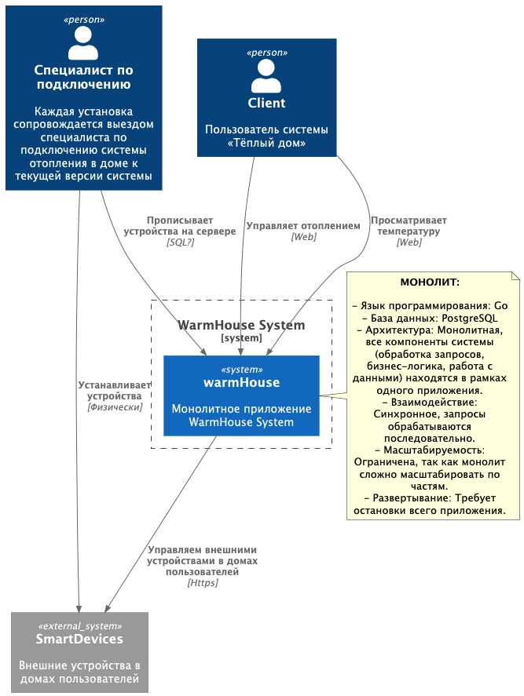
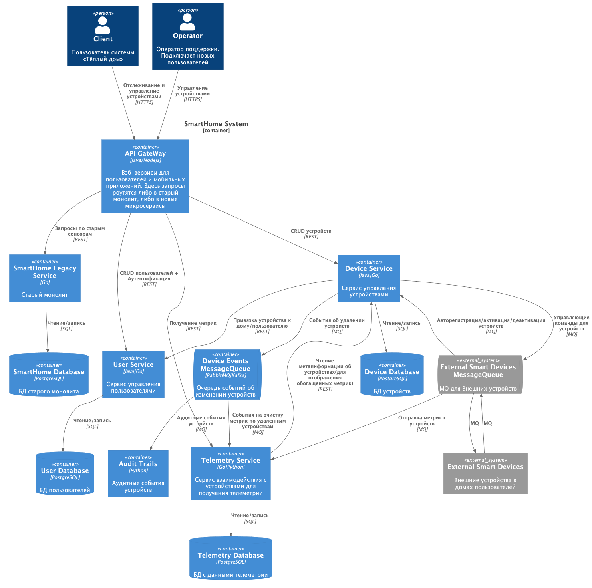
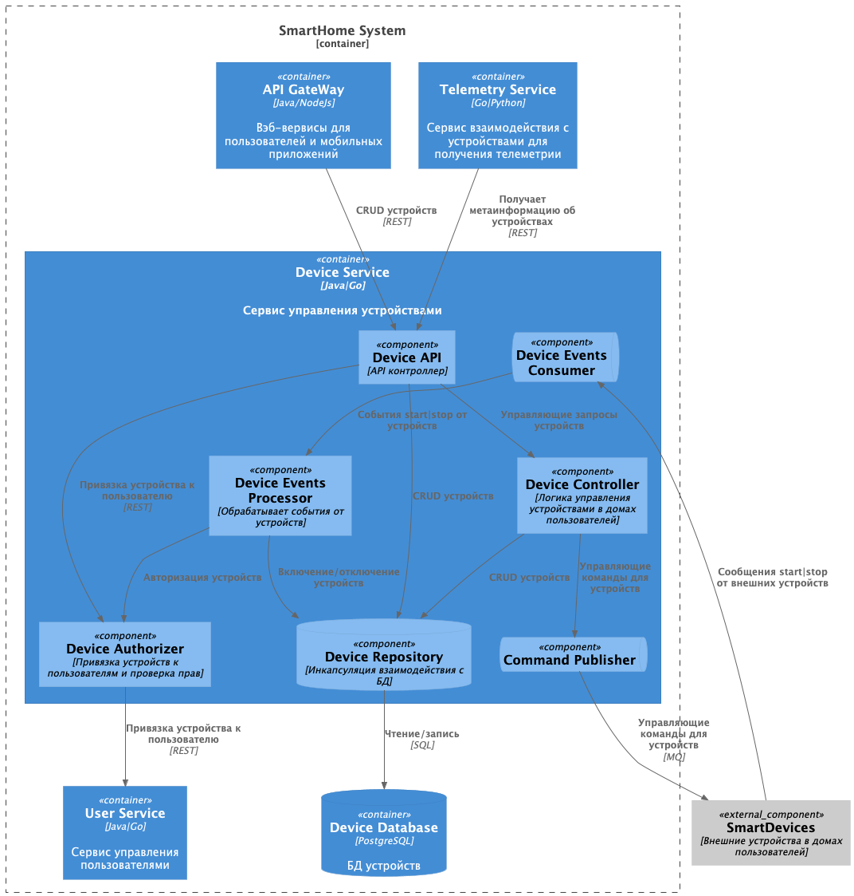
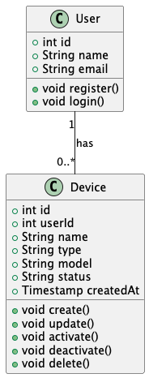
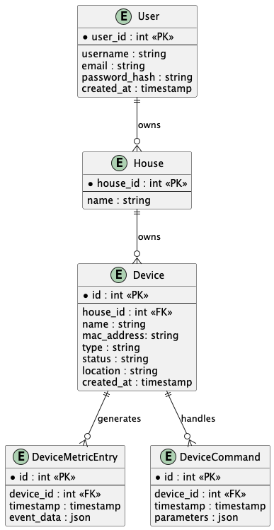

# Project_template

Это шаблон для решения проектной работы. Структура этого файла повторяет структуру заданий. Заполняйте его по мере работы над решением.

# Задание 1. Анализ и планирование

<aside>

Чтобы составить документ с описанием текущей архитектуры приложения, можно часть информации взять из описания компании и условия задания. Это нормально.

</aside>

### 1. Описание функциональности монолитного приложения

**Управление отоплением:**

- Пользователи могут удалённо включать/выключать отопление в своих домах.
- Самостоятельно подключить свой датчик к системе пользователь не может.

**Мониторинг температуры:**

- Пользователи могут просматривать текущую температуру в своих домах через веб-интерфейс.
- Система получает данные о температуре с датчиков, установленных в домах. 
- Данные о температуре также получаются через запрос от сервера к датчику.

### 2. Анализ архитектуры монолитного приложения

- Язык программирования: Go
- База данных: PostgreSQL
- Архитектура: Монолитная, все компоненты системы (обработка запросов, бизнес-логика, работа с данными) находятся в рамках одного приложения.
- Взаимодействие: Синхронное, запросы обрабатываются последовательно.
- Масштабируемость: Ограничена, так как монолит сложно масштабировать по частям.
- Развертывание: Требует остановки всего приложения.

### 3. Определение доменов и границы контекстов

- Домен Телеметрии
  - Поддомен: работа с датчиками температуры
    - контекст: опрос датчиков температуры системой WarmHouse
    - контекст: предоставление пользователю данных с датчиков
- Домен Управление устройствами отопления
  - Поддомен: устройства отопления
    - котекст: управление устройсвами отопления
- Домен Управления Пользователями и Домами (сейчас выполняется вручную?)

### **4. Проблемы монолитного решения**

- Высокий риск ошибок.
- Длительные циклы разработки и развёртывания.
- Трудно управлять командой.
- Трудно масштабировать отдельные компоненты системы.

### 5. Визуализация контекста системы — диаграмма С4

[Диаграмма контекста в модели C4.](./schemas/C4_context_existing.puml)



# Задание 2. Проектирование микросервисной архитектуры

В этом задании вам нужно предоставить только диаграммы в модели C4. Мы не просим вас отдельно описывать получившиеся микросервисы и то, как вы определили взаимодействия между компонентами To-Be системы. Если вы правильно подготовите диаграммы C4, они и так это покажут.

**Диаграмма контейнеров (Containers)**

[Диаграмма контейнеров в модели C4.](./schemas/C4_container.puml)



**Диаграмма компонентов (Components)**

[Диаграмма компонентов в модели C4.](./schemas/C4_component.puml)



**Диаграмма кода (Code)**

[Диаграмма кода в модели C4.](./schemas/C4_code.puml)



# Задание 3. Разработка ER-диаграммы

[ER-диаграмма.](./schemas/ER.puml)



Добавьте сюда ER-диаграмму. Она должна отражать ключевые сущности системы, их атрибуты и тип связей между ними.

# Задание 4. Создание и документирование API

### 1. Тип API

Будем использовать REST-API для Control-plane части:
- для CRUD запросов для менеджмента устройствами;
- а также для CPL запросов между микросервисами (проверка существования устройств/домов/пользователей, а также их редактирование);

Будем использовать очереди сообщений (RabbitMQ/Kafka):
- для отправки событий об CRUD операциях из сервиса устройств;
- для оправки метрик их физических устройств в домах пользователей и их получение в сервисе телеметрии;
- для отправки команд на выполнение из сервиса устройств и получение их физическими устройствами в доме пользователя;

### 2. Документация API

Для запуска все микросервисов достаточно запустить docker-compose
```bash
docker compose -f apps/docker-compose.yml up --build
```

Swagger документация доступна по ссылкам
- [Swagger-UI device-service](http://localhost:8083/swagger-ui/index.html)
- [Swagger-UI telemetry-service](http://localhost:8084/swagger-ui/index.html)

### 3. Эмулятор физических устройств в доме пользователя

Для полноценной демонстрации можно запустить эмулятор физических устройств в доме пользователя.

#### Запустить эмулятор

```bash
docker build -t home-device-emulator ./apps/home-device-emulator && docker run --network host -it home-device-emulator
```

1. Введите идентификатор дома (подойдет любое положительное число, так как сервис управления домами не реализован).
2. Введите строку с названием помещения.
3. Эмулятор создаст и покажет идентификаторы созданной пары устройств `TEMPERATURE_SENSOR` и `HEATER`
4. Устройства начнут отправлять раз в 10 секунд хертбиты/метрики в запустившийся сервис телеметрии.

#### Для задания желаемой температуры в комнате

установите желаемое значение на устройстве типа `HEATER` с помощью `curl`
DEVICE_ID=<тут стоит ввести ID устройства типа `HEATER` >
```bash
curl -X POST -H 'Content-Type: application/json' -d '{"value": 28.0}' http://localhost:8083/api/v1/devices/setValue/${DEVICE_ID?}
```

После этого эмулятор начнет пытаться "привести температуру" ближе к желаемой итерациями +-1 градус,
что можно будет увидеть в метриках устройства типа `TEMPERATURE_SENSOR`

#### Для активации|деактивации эмулируемых устройств

можно использовать `curl`

```bash
curl -X POST http://localhost:8083/api/v1/devices/activate/${DEVICE_ID?}
```

```bash
curl -X POST http://localhost:8083/api/v1/devices/deactivate/${DEVICE_ID?}
```

#### Для удаления устройств выполните

```bash
curl -X DELETE http://localhost:8083/api/v1/devices/${DEVICE_ID?}
```

После удаления всех устройств эмулятор завершит работу

#### Посмотреть последние метрики в сервисе телеметрии

```bash
curl -X DELETE http://localhost:8084/api/v1/metrics
```


# Задание 5. Работа с docker и docker-compose

**DONE**

Перейдите в apps.

Там находится приложение-монолит для работы с датчиками температуры. В README.md описано как запустить решение.

Вам нужно:

1) сделать простое приложение temperature-api на любом удобном для вас языке программирования, которое при запросе /temperature?location= будет отдавать рандомное значение температуры.

Locations - название комнаты, sensorId - идентификатор названия комнаты

```
	// If no location is provided, use a default based on sensor ID
	if location == "" {
		switch sensorID {
		case "1":
			location = "Living Room"
		case "2":
			location = "Bedroom"
		case "3":
			location = "Kitchen"
		default:
			location = "Unknown"
		}
	}

	// If no sensor ID is provided, generate one based on location
	if sensorID == "" {
		switch location {
		case "Living Room":
			sensorID = "1"
		case "Bedroom":
			sensorID = "2"
		case "Kitchen":
			sensorID = "3"
		default:
			sensorID = "0"
		}
	}
```

2) Приложение следует упаковать в Docker и добавить в docker-compose. Порт по умолчанию должен быть 8081

3) Кроме того для smart_home приложения требуется база данных - добавьте в docker-compose файл настройки для запуска postgres с указанием скрипта инициализации ./smart_home/init.sql

Для проверки можно использовать Postman коллекцию smarthome-api.postman_collection.json и вызвать:

- Create Sensor
- Get All Sensors

Должно при каждом вызове отображаться разное значение температуры

Ревьюер будет проверять точно так же.


# **Задание 6. Разработка MVP**

**DONE**

Необходимо создать новые микросервисы и обеспечить их интеграции с существующим монолитом для плавного перехода к микросервисной архитектуре. 

### **Что нужно сделать**

1. Создайте новые микросервисы для управления телеметрией и устройствами (с простейшей логикой), которые будут интегрированы с существующим монолитным приложением. Каждый микросервис на своем ООП языке.
2. Обеспечьте взаимодействие между микросервисами и монолитом (при желании с помощью брокера сообщений), чтобы постепенно перенести функциональность из монолита в микросервисы. 

В результате у вас должны быть созданы Dockerfiles и docker-compose для запуска микросервисов. 