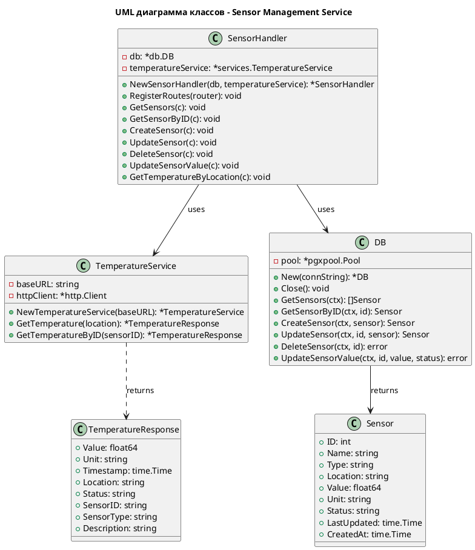
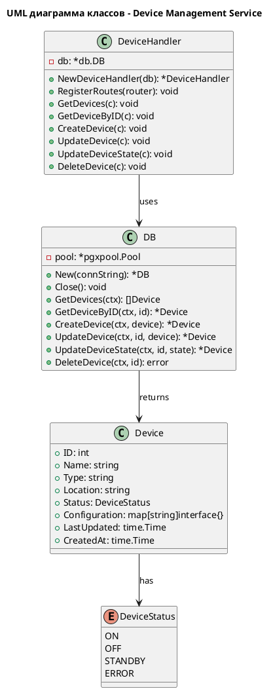
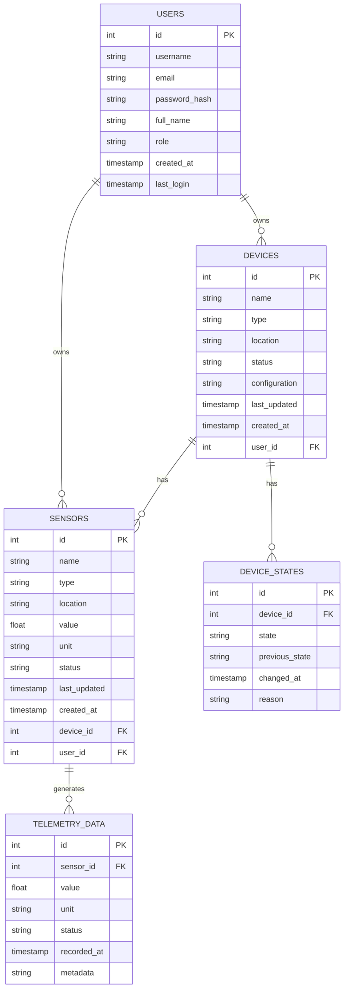

# Project_template

Это шаблон для решения проектной работы. Структура этого файла повторяет структуру заданий. Заполняйте его по мере работы над решением.

# Задание 1. Анализ и планирование

<aside>

Чтобы составить документ с описанием текущей архитектуры приложения, можно часть информации взять из описания компании и условия задания. Это нормально.

</aside

### 1. Описание функциональности монолитного приложения

**Управление датчиками:**

- Пользователи могут создавать новые датчики с указанием типа, названия и местоположения
- Система поддерживает управление жизненным циклом датчиков (создание, чтение, обновление, удаление)
- Пользователи могут обновлять значения датчиков и их статусы вручную
- Система автоматически отслеживает время последнего обновления данных датчиков

**Мониторинг температуры:**

- Пользователи могут получать актуальные данные о температуре по местоположению
- Система поддерживает интеграцию с внешним API для получения реальных значений температуры
- Пользователи могут просматривать список всех датчиков с актуальными значениями температуры
- Система автоматически обновляет данные температуры при запросах к датчикам

### 2. Анализ архитектуры монолитного приложения

**Технологический стек:**
- Язык программирования: Go 1.22
- Веб-фреймворк: Gin
- База данных: PostgreSQL 16
- Драйвер БД: pgx/v5
- Контейнеризация: Docker

**Архитектурные особенности:**
- Монолитное приложение с четким разделением на слои:
  - **Handlers** - обработка HTTP-запросов и валидация входных данных
  - **Services** - бизнес-логика и интеграция с внешними сервисами (temperature-api)
  - **Models** - структуры данных и модели предметной области
  - **DB** - слой доступа к данным, работа с PostgreSQL

**Взаимодействие компонентов:**
- HTTP-сервер на порту 8080 обрабатывает REST API запросы
- Прямое подключение к PostgreSQL через connection pool
- Синхронные HTTP-вызовы к внешнему temperature-api сервису для получения актуальных данных
- Все компоненты находятся в одном процессе, что обеспечивает простоту развертывания, но создает единую точку отказа

### 3. Определение доменов и границы контекстов

**Домен "Управление датчиками" (Sensor Management):**
- Отвечает за CRUD-операции с датчиками
- Управление метаданными датчиков (название, тип, местоположение, статус)
- Хранение исторических данных о значениях датчиков
- Граница: включает модели Sensor, репозиторий для работы с БД, обработчики HTTP-запросов

**Домен "Телеметрия" (Telemetry):**
- Отвечает за сбор и предоставление актуальных данных с датчиков
- Интеграция с внешними источниками данных (temperature-api)
- Агрегация и обработка телеметрических данных
- Граница: включает сервис получения температуры, логику обновления значений датчиков

**Домен "Управление устройствами" (Device Management):**
- Отвечает за управление физическими устройствами умного дома
- Контроль состояния устройств (включено/выключено, активное/неактивное)
- Управление конфигурацией устройств
- Граница: в текущем монолите частично реализован через статусы датчиков, но требует выделения в отдельный домен

### **4. Проблемы монолитного решения**

- **Масштабируемость**: Невозможно масштабировать отдельные компоненты независимо. При росте нагрузки на телеметрию приходится масштабировать весь монолит
- **Технологические ограничения**: Все компоненты должны использовать один технологический стек (Go), что ограничивает выбор инструментов для разных задач
- **Единая точка отказа**: Падение любого компонента приводит к недоступности всего приложения
- **Сложность развертывания**: Любое изменение требует пересборки и перезапуска всего приложения
- **Тесная связанность**: Компоненты тесно связаны между собой, что усложняет тестирование и поддержку
- **Блокирующие операции**: Синхронные вызовы к внешнему API могут блокировать обработку других запросов
- **Сложность командной разработки**: Несколько разработчиков работают над одним кодом, что создает конфликты и замедляет разработку

### 5. Визуализация контекста системы — диаграмма С4

Диаграмма контекста системы (C4 Level 1):

```plantuml
@startuml
!include https://raw.githubusercontent.com/plantuml-stdlib/C4-PlantUML/master/C4_Context.puml

LAYOUT_WITH_LEGEND()

title Контекстная диаграмма Smart Home System

Person(user, "Пользователь", "Использует систему для управления умным домом")
System(smarthome, "Smart Home Monolith", "Монолитное приложение для управления датчиками и устройствами")
System_Ext(temperature_api, "Temperature API", "Внешний сервис для получения данных о температуре")
SystemDb(postgres, "PostgreSQL", "База данных для хранения информации о датчиках")

Rel(user, smarthome, "Использует", "HTTP/REST")
Rel(smarthome, postgres, "Читает и записывает", "SQL")
Rel(smarthome, temperature_api, "Получает данные", "HTTP/REST")

@enduml
```

# Задание 2. Проектирование микросервисной архитектуры

В этом задании вам нужно предоставить только диаграммы в модели C4. Мы не просим вас отдельно описывать получившиеся микросервисы и то, как вы определили взаимодействия между компонентами To-Be системы. Если вы правильно подготовите диаграммы C4, они и так это покажут.

**Диаграмма контейнеров (Containers)**

```plantuml
@startuml
!include https://raw.githubusercontent.com/plantuml-stdlib/C4-PlantUML/master/C4_Container.puml

LAYOUT_WITH_LEGEND()

title Диаграмма контейнеров Smart Home System

Person(user, "Пользователь", "Использует систему для управления умным домом")

System_Boundary(smarthome, "Smart Home System") {
    Container(sensor_service, "Sensor Management Service", "Go, REST API", "Управление датчиками и их метаданными")
    Container(telemetry_service, "Telemetry Service", "Go, REST API", "Сбор, обработка и хранение телеметрии")
    Container(device_service, "Device Management Service", "Go, REST API", "Управление устройствами и их состояниями")
    Container(api_gateway, "API Gateway", "Nginx/Envoy", "Единая точка входа, маршрутизация запросов")
    ContainerDb(sensor_db, "Sensor Database", "PostgreSQL", "Хранение метаданных датчиков")
    ContainerDb(telemetry_db, "Telemetry Database", "PostgreSQL", "Хранение телеметрических данных")
    ContainerDb(device_db, "Device Database", "PostgreSQL", "Хранение данных устройств")
    Container_Ext(temperature_api, "Temperature API", "External Service", "Внешний сервис для получения данных о температуре")
    Container_Ext(message_broker, "Message Broker", "RabbitMQ/Kafka", "Асинхронная коммуникация между сервисами")
}

Rel(user, api_gateway, "Использует", "HTTP/REST")
Rel(api_gateway, sensor_service, "Маршрутизирует запросы", "HTTP/REST")
Rel(api_gateway, telemetry_service, "Маршрутизирует запросы", "HTTP/REST")
Rel(api_gateway, device_service, "Маршрутизирует запросы", "HTTP/REST")
Rel(sensor_service, sensor_db, "Читает и записывает", "SQL")
Rel(sensor_service, temperature_api, "Получает данные о температуре", "HTTP/REST")
Rel(telemetry_service, telemetry_db, "Читает и записывает", "SQL")
Rel(device_service, device_db, "Читает и записывает", "SQL")
Rel(sensor_service, message_broker, "Публикует события", "AMQP/Kafka")
Rel(telemetry_service, message_broker, "Подписывается на события", "AMQP/Kafka")
Rel(device_service, message_broker, "Подписывается на события", "AMQP/Kafka")

@enduml
```

**Диаграмма компонентов (Components)**

**Sensor Management Service:**
```plantuml
@startuml
!include https://raw.githubusercontent.com/plantuml-stdlib/C4-PlantUML/master/C4_Component.puml

LAYOUT_WITH_LEGEND()

title Компоненты Sensor Management Service

Container(sensor_service, "Sensor Management Service", "Go", "Управление датчиками")

Component(sensor_handler, "Sensor Handler", "HTTP handlers", "Обработка HTTP запросов, валидация входных данных")
Component(temperature_service, "Temperature Service", "External API client", "Интеграция с внешним Temperature API")
Component(sensor_repository, "Sensor Repository", "Data access", "CRUD операции с датчиками в БД")
Component(event_publisher, "Event Publisher", "Messaging", "Публикация событий о изменениях датчиков")

ContainerDb_Ext(sensor_db, "Sensor Database", "PostgreSQL", "Хранение метаданных датчиков")
Container_Ext(temperature_api, "Temperature API", "External Service", "Внешний сервис температуры")
Container_Ext(message_broker, "Message Broker", "RabbitMQ/Kafka", "Асинхронная коммуникация")

Rel(sensor_handler, temperature_service, "Использует для получения температуры", "Go method call")
Rel(sensor_handler, sensor_repository, "Использует для работы с данными", "Go method call")
Rel(sensor_handler, event_publisher, "Публикует события", "Go method call")
Rel(sensor_repository, sensor_db, "Читает и записывает", "SQL")
Rel(temperature_service, temperature_api, "Получает данные", "HTTP/REST")
Rel(event_publisher, message_broker, "Публикует сообщения", "AMQP/Kafka")

@enduml
```

**Telemetry Service:**
```plantuml
@startuml
!include https://raw.githubusercontent.com/plantuml-stdlib/C4-PlantUML/master/C4_Component.puml

LAYOUT_WITH_LEGEND()

title Компоненты Telemetry Service

Container(telemetry_service, "Telemetry Service", "Go", "Сбор и обработка телеметрии")

Component(telemetry_handler, "Telemetry Handler", "HTTP handlers", "Обработка HTTP запросов, валидация")
Component(telemetry_repository, "Telemetry Repository", "Data access", "CRUD операции с телеметрией")
Component(event_subscriber, "Event Subscriber", "Messaging", "Подписка на события от других сервисов")

ContainerDb_Ext(telemetry_db, "Telemetry Database", "PostgreSQL", "Хранение телеметрических данных")
Container_Ext(message_broker, "Message Broker", "RabbitMQ/Kafka", "Асинхронная коммуникация")

Rel(telemetry_handler, telemetry_repository, "Использует для работы с данными", "Go method call")
Rel(telemetry_handler, event_subscriber, "Обрабатывает события", "Go method call")
Rel(telemetry_repository, telemetry_db, "Читает и записывает", "SQL")
Rel(event_subscriber, message_broker, "Подписывается на топики", "AMQP/Kafka")

@enduml
```

**Device Management Service:**
```plantuml
@startuml
!include https://raw.githubusercontent.com/plantuml-stdlib/C4-PlantUML/master/C4_Component.puml

LAYOUT_WITH_LEGEND()

title Компоненты Device Management Service

Container(device_service, "Device Management Service", "Go", "Управление устройствами")

Component(device_handler, "Device Handler", "HTTP handlers", "Обработка HTTP запросов, валидация")
Component(device_repository, "Device Repository", "Data access", "CRUD операции с устройствами, управление состояниями")
Component(event_subscriber, "Event Subscriber", "Messaging", "Подписка на события от других сервисов")

ContainerDb_Ext(device_db, "Device Database", "PostgreSQL", "Хранение данных устройств")
Container_Ext(message_broker, "Message Broker", "RabbitMQ/Kafka", "Асинхронная коммуникация")

Rel(device_handler, device_repository, "Использует для работы с данными", "Go method call")
Rel(device_handler, event_subscriber, "Обрабатывает события", "Go method call")
Rel(device_repository, device_db, "Читает и записывает", "SQL")
Rel(event_subscriber, message_broker, "Подписывается на топики", "AMQP/Kafka")

@enduml
```

**Диаграмма кода (Code)**

**UML диаграмма классов - Sensor Management Service:**


**UML диаграмма классов - Device Management Service:**


# Задание 3. Разработка ER-диаграммы

ER-диаграмма ключевых сущностей системы:



**Описание сущностей:**

- **USERS** - Пользователи системы умного дома. Хранят информацию о владельцах устройств и датчиков
- **SENSORS** - Датчики умного дома. Хранят метаданные и текущие значения датчиков
- **DEVICES** - Устройства умного дома. Физические устройства, к которым привязаны датчики
- **TELEMETRY_DATA** - Исторические данные телеметрии. Хранит временные ряды значений датчиков
- **DEVICE_STATES** - История состояний устройств. Отслеживает изменения состояний устройств

**Типы связей:**
- USERS (1) → (N) DEVICES: Один пользователь может владеть несколькими устройствами
- USERS (1) → (N) SENSORS: Один пользователь может владеть несколькими датчиками
- DEVICES (1) → (N) SENSORS: Одно устройство может иметь несколько датчиков
- SENSORS (1) → (N) TELEMETRY_DATA: Один датчик генерирует множество записей телеметрии
- DEVICES (1) → (N) DEVICE_STATES: Одно устройство имеет историю состояний

# Задание 4. Создание и документирование API

### 1. Тип API

**REST API (HTTP/JSON)** - выбран для синхронного взаимодействия между микросервисами и клиентами.

**Обоснование:**
- Простота реализации и отладки
- Широкая поддержка в различных языках программирования
- Легкая интеграция с существующими инструментами (Postman, curl)
- Хорошая читаемость и понятность для разработчиков
- Стандартизированный подход к обработке ошибок через HTTP статус-коды

**Асинхронная коммуникация (Message Broker/Apache Kafka)** - используется для событийно-ориентированного взаимодействия между микросервисами.

**Обоснование:**
- Развязка сервисов во времени
- Повышение отказоустойчивости (очереди сообщений)
- Возможность масштабирования обработчиков событий
- Поддержка паттернов pub/sub для распространения событий

### 2. Документация API

Документация API создана в формате OpenAPI 3.0 и находится в директории `schemas/`:

- [Sensor Management Service API](schemas/sensor-service-api.yaml) - API для управления датчиками
- [Telemetry Service API](schemas/telemetry-service-api.yaml) - API для работы с телеметрией
- [Device Management Service API](schemas/device-service-api.yaml) - API для управления устройствами

Для просмотра документации можно использовать:
- [Swagger Editor](https://editor.swagger.io/) - онлайн редактор для просмотра и редактирования
- Swagger UI - локальный запуск через Docker
- [Интеграция в IDE с поддержкой OpenAPI](OPENAPI_SETUP.md) - подробная инструкция по настройке OpenAPI в VS Code/Cursor

**Основные эндпоинты:**

**Sensor Management Service:**
- `GET /api/v1/sensors` - получить список всех датчиков
- `GET /api/v1/sensors/{id}` - получить датчик по ID
- `POST /api/v1/sensors` - создать новый датчик
- `PUT /api/v1/sensors/{id}` - обновить датчик
- `DELETE /api/v1/sensors/{id}` - удалить датчик

**Telemetry Service:**
- `GET /api/v1/telemetry/sensors/{sensorId}` - получить телеметрию по датчику
- `GET /api/v1/telemetry/sensors/{sensorId}/history` - получить историю телеметрии
- `POST /api/v1/telemetry/collect` - собрать телеметрию с датчиков

**Device Management Service:**
- `GET /api/v1/devices` - получить список устройств
- `GET /api/v1/devices/{id}` - получить устройство по ID
- `POST /api/v1/devices` - создать новое устройство
- `PUT /api/v1/devices/{id}` - обновить устройство
- `PATCH /api/v1/devices/{id}/state` - изменить состояние устройства

# Задание 5. Работа с docker и docker-compose

Перейдите в apps.

Там находится приложение-монолит для работы с датчиками температуры. В README.md описано как запустить решение.

Вам нужно:

1) сделать простое приложение temperature-api на любом удобном для вас языке программирования, которое при запросе /temperature?location= будет отдавать рандомное значение температуры.

Locations - название комнаты, sensorId - идентификатор названия комнаты

```
	// If no location is provided, use a default based on sensor ID
	if location == "" {
		switch sensorID {
		case "1":
			location = "Living Room"
		case "2":
			location = "Bedroom"
		case "3":
			location = "Kitchen"
		default:
			location = "Unknown"
		}
	}

	// If no sensor ID is provided, generate one based on location
	if sensorID == "" {
		switch location {
		case "Living Room":
			sensorID = "1"
		case "Bedroom":
			sensorID = "2"
		case "Kitchen":
			sensorID = "3"
		default:
			sensorID = "0"
		}
	}
```

2) Приложение следует упаковать в Docker и добавить в docker-compose. Порт по умолчанию должен быть 8081

3) Кроме того для smart_home приложения требуется база данных - добавьте в docker-compose файл настройки для запуска postgres с указанием скрипта инициализации ./smart_home/init.sql

Для проверки можно использовать Postman коллекцию smarthome-api.postman_collection.json и вызвать:

- Create Sensor
- Get All Sensors

Должно при каждом вызове отображаться разное значение температуры

Ревьюер будет проверять точно так же.

### **Реализация**

**1. Приложение temperature-api:**

Создано простое приложение на **Go 1.22**, которое имитирует работу удалённого датчика температуры.

**Функциональность:**
- Обработка запросов `GET /temperature?location=<название_комнаты>`
- Генерация случайного значения температуры в диапазоне 18-25°C при каждом запросе
- Поддержка параметров `location` и `sensorId` с автоматическим маппингом между ними
- Дополнительные эндпоинты:
  - `GET /temperature/{id}` - получение температуры по ID датчика
  - `GET /health` - проверка здоровья сервиса

**Технологии:**
- Язык: Go 1.22
- Стандартная библиотека `net/http` для HTTP-сервера
- Генератор случайных чисел `math/rand` для создания уникальных значений температуры

**Расположение:** `apps/temperature-api/`

**2. Docker контейнеризация:**

Создан многоэтапный Dockerfile для оптимизации размера образа:
- **Build stage**: компиляция Go приложения
- **Runtime stage**: минимальный Alpine образ с готовым бинарным файлом

**Порт:** 8081 (настраивается через переменную окружения `PORT`)

**3. Docker Compose конфигурация:**

Обновлен файл `apps/docker-compose.yml`:

**Temperature API сервис:**
- Сборка из `./temperature-api`
- Порт: `8081:8081`
- Переменная окружения: `PORT=:8081`
- Подключен к сети `smarthome-network`

**PostgreSQL сервис:**
- Образ: `postgres:16-alpine`
- База данных: `smarthome`
- Скрипты инициализации:
  - `./init-all-databases.sql` - создание всех баз данных (smarthome, telemetry, devices)
  - `./smart_home/init.sql` - создание таблицы sensors в базе smarthome
- Healthcheck для обеспечения готовности базы данных перед запуском зависимых сервисов

**Зависимости:**
- Сервис `app` (smart_home) зависит от `postgres` (condition: service_healthy) и `temperature-api` (condition: service_started)

**Запуск:**

```bash
cd apps
docker-compose up -d
```

**Проверка работы:**

1. **Temperature API:**
   ```bash
   curl http://localhost:8081/temperature?location=Living%20Room
   ```
   При каждом запросе возвращается новое случайное значение температуры.

2. **Создание датчика через Postman:**
   - Использовать коллекцию `smarthome-api.postman_collection.json`
   - Вызвать **Create Sensor** - создаст новый датчик
   - Вызвать **Get All Sensors** - получит список всех датчиков с актуальными значениями температуры

3. **Проверка базы данных:**
   ```bash
   docker exec -it smarthome-postgres psql -U postgres -d smarthome -c "SELECT * FROM sensors;"
   ```


# **Задание 6. Разработка MVP**

Необходимо создать новые микросервисы и обеспечить их интеграции с существующим монолитом для плавного перехода к микросервисной архитектуре. 

### **Что нужно сделать**

1. Создайте новые микросервисы для управления телеметрией и устройствами (с простейшей логикой), которые будут интегрированы с существующим монолитным приложением. Каждый микросервис на своем ООП языке.
2. Обеспечьте взаимодействие между микросервисами и монолитом (при желании с помощью брокера сообщений), чтобы постепенно перенести функциональность из монолита в микросервисы. 

В результате у вас должны быть созданы Dockerfiles и docker-compose для запуска микросервисов.

### **Реализация**

**Созданные микросервисы:**

Все микросервисы используют единый технологический стек **Go**:

1. **Telemetry Service** (Go/Gin)
   - Порт: 8082
   - Функциональность:
     - Получение текущей телеметрии по датчику
     - Получение истории телеметрических данных
     - Сбор телеметрии с датчиков
   - База данных: PostgreSQL (database: telemetry)
   - Расположение: `apps/telemetry-service/`

2. **Device Management Service** (Go/Gin)
   - Порт: 8083
   - Функциональность:
     - CRUD операции для устройств
     - Управление состояниями устройств
     - Получение списка устройств с фильтрацией
   - База данных: PostgreSQL (database: devices)
   - Расположение: `apps/device-service/`

**Единый технологический стек:**
- Язык программирования: **Go 1.22**
- Веб-фреймворк: **Gin**
- База данных: **PostgreSQL 16**
- Драйвер БД: **pgx/v5**
- Контейнеризация: **Docker**

**Инфраструктура:**

- **Apache Kafka** - брокер сообщений для асинхронной коммуникации между микросервисами
  - Порт: 9092 (Kafka), 9093 (Kafka SSL), 8083 (Schema Registry)
  - Управление через Kafka UI или Confluent Control Center

- **PostgreSQL** - общая база данных с отдельными схемами для каждого сервиса:
  - `smarthome` - для монолитного приложения
  - `telemetry` - для сервиса телеметрии
  - `devices` - для сервиса управления устройствами

**Docker Compose:**

Все сервисы настроены в `apps/docker-compose.yml`:
- Монолитное приложение (smart_home)
- Temperature API
- Telemetry Service
- Device Management Service
- PostgreSQL
- Apache Kafka

**Запуск:**

```bash
cd apps
docker-compose up -d
```

**Проверка работы:**

- Монолит: http://localhost:8080/api/v1/sensors
- Temperature API: http://localhost:8081/temperature?location=Living%20Room
- Telemetry Service: http://localhost:8082/api/v1/telemetry/sensors/1
- Device Service: http://localhost:8083/api/v1/devices
- Kafka UI: http://localhost:8080 (если используется Kafka UI) 